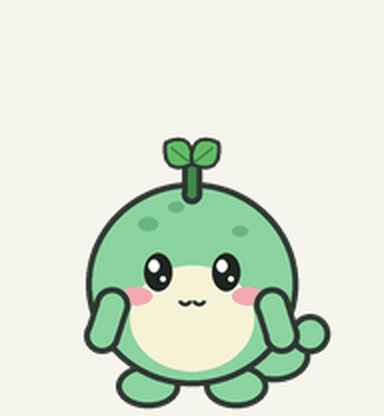
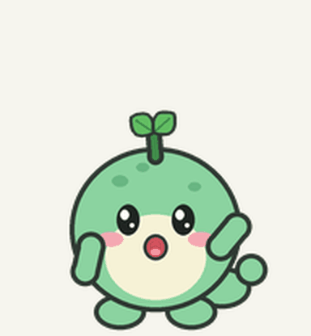
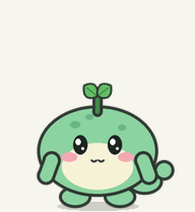
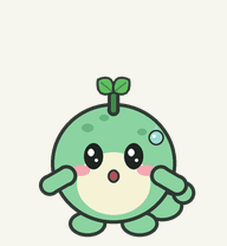
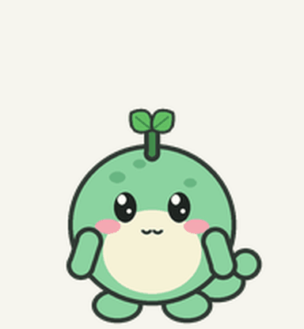

<div align="center">

# Desktop Pets

**Codex 데스크톱 앱용 오리지널 펫 모음**


</div>

---

Codex pet v2 형식(192 × 208 칸 8 × 11 격자, 1536 × 2288 투명 PNG)을 따르는 펫들이에요. 상태 애니메이션 9종과 16방향 시선 루프가 들어 있어요.

## 캐릭터

### 새싹이 (`sprouty`)

머리에 새싹이 난 민트색 도마뱀이에요. 작업이 끝나 검토(review) 상태가 되면 크리스털 뿔과 잎 망토를 두른 **숲의 수호자**로 진화해요.

<table>
<tr><th><sub>Idle</sub></th><th><sub>Run →</sub></th><th><sub>Run ←</sub></th><th><sub>Wave</sub></th><th><sub>Jump</sub></th></tr>
<tr>
<td></td>
<td></td>
<td></td>
<td></td>
<td></td>
</tr>
<tr><th><sub>Failed</sub></th><th><sub>Waiting</sub></th><th><sub>Working</sub></th><th><sub>Review (진화)</sub></th><th><sub>16-way look</sub></th></tr>
<tr>
<td></td>
<td></td>
<td></td>
<td></td>
<td></td>
</tr>
</table>

> 진화 연출은 review 애니메이션 동안만 보이고, 다른 상태로 넘어가면 다시 새싹이로 돌아와요.

## 설치

**macOS · Linux**

```bash
curl -fsSL https://raw.githubusercontent.com/60jong/desktop-pets/main/install.sh | sh
```

**Windows (PowerShell)**

```powershell
irm https://raw.githubusercontent.com/60jong/desktop-pets/main/install.ps1 | iex
```

설치 후 Codex를 재시작하고 펫 목록에서 고르면 돼요. 일부만 설치하려면 `DESKTOP_PETS`에 펫 ID를 쉼표로 넣어주세요.

**수동 설치:** `pets/<펫ID>/` 폴더(`pet.json` + `spritesheet.png`)를 `~/.codex/pets/`에 복사하세요. Windows는 `%USERPROFILE%\.codex\pets\`예요.

## 스프라이트 형식

| 행 | 상태 | 프레임 |
|:-:|:--|:-:|
| 0 | idle | 6 |
| 1 | running-right | 8 |
| 2 | running-left | 8 |
| 3 | waving | 4 |
| 4 | jumping | 5 |
| 5 | failed | 8 |
| 6 | waiting | 6 |
| 7 | running (작업 중) | 6 |
| 8 | review | 6 |
| 9 – 10 | look, 12시부터 시계방향 16방향 | 16 |

```json
{
  "id": "sprouty",
  "displayName": "Sprouty",
  "description": "A sprout gecko that evolves into the Grove Warden when work is done.",
  "spriteVersionNumber": 2,
  "spritesheetPath": "spritesheet.png"
}
```

## 다시 만들기

새싹이는 코드로 그려져요. Python과 Pillow만 있으면 시트와 미리보기를 다시 생성할 수 있어요.

```bash
pip install pillow
python3 tools/build_sprouty.py build
```

`build/sprouty/`에 펫 폴더가, `build/previews/`에 상태별 GIF가 생겨요.
